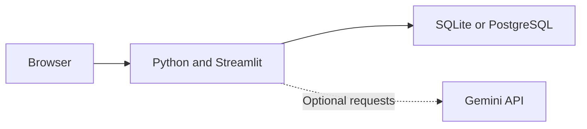

# AI Study Planner

Turn exam goals, available time, and practice results into a study plan you can explain and adjust.

Built by **Priti Kumari** with Python and Streamlit. Plan, review, and track progress in your own account; add optional Gemini assistance when you need help with your notes.


[](https://github.com/Priti02707/AI--Study-Planner/actions/workflows/tests.yml)

[Live app](https://ai-study-planner-lac.vercel.app) · [User guide](docs/guide.md) · [Deployment](DEPLOYMENT.md) · [Changelog](CHANGELOG.md)

## Overview

Study time is limited, and a timetable needs to change when work is missed or a topic needs more practice. AI Study Planner builds sessions around your exam dates, topic workload, and free windows, then helps you revise the plan as you record results.

The core planner runs locally without an API key. Scheduling uses transparent rules; optional AI features assist with uploaded material. Every planned session includes a reason, and work that does not fit is reported rather than hidden.

## Key features

| Feature | What you can do |
| --- | --- |
| Private accounts | Register, sign in, change your password, and keep study records separate from other students. |
| Study coach | Set up subjects and goals, check recall, and preview a starting plan before accepting it. |
| Flexible planning | Schedule around multiple daily windows, breaks, days off, exam deadlines, and topic prerequisites. |
| Adaptive revision | Record quizzes and completed, partial, or skipped sessions; update future priorities while preserving finished work. |
| Practice and notes | Review flashcards, keep a mistake notebook, import PDF/text notes, and search source passages. |
| Optional Gemini assistance | Review extracted topics, generate source-based quizzes with suggested difficulty, and ask questions about your notes. |
| Progress and exports | Track study activity, use a focus timer, and export timetables to CSV/calendar or study records to JSON. |

## Tech stack

| Area | Technology |
| --- | --- |
| Application | Python 3.12–3.14, Streamlit 1.66.1 |
| Storage | SQLite locally; PostgreSQL with Psycopg when hosted |
| Documents and AI | pypdf 6.21.4; optional Google Gemini API |
| Hosting | Vercel Python Function with ASGI; static browser assets on its CDN |
| Verification | Python unittest, Streamlit AppTest, GitHub Actions |

## Architecture



The Python application handles accounts, scheduling, practice, and document retrieval. Each account uses a separate local database file or PostgreSQL schema. The dashboard connects over WebSocket; hosted browser assets are delivered separately from application data.

See [Algorithms](docs/algorithms.md) for scheduling priorities, duration adaptation, and spaced-review rules.

## Getting started

Install **Python 3.12, 3.13, or 3.14** and Git. A local database is created automatically; PostgreSQL is only required for hosted use.

```bash
git clone https://github.com/Priti02707/AI--Study-Planner.git
cd AI--Study-Planner
python3 -m venv .venv
source .venv/bin/activate
python -m pip install -r requirements.txt
python -m streamlit run app.py
```

On Windows PowerShell, replace the activation command with `.venv\Scripts\Activate.ps1`. Open **http://localhost:8501**, then choose **Create account**. Passwords must contain at least 12 characters; set your own security question and save the generated recovery code.

For the smaller console edition, run `python python.py`. It allocates daily minutes from subject marks; accounts and dated timetables belong to the dashboard.

### Optional AI configuration

Export these variables before starting the dashboard:

```bash
export GEMINI_API_KEY="your-key"
export GEMINI_MODEL="gemini-2.5-flash"
python -m streamlit run app.py
```

For PowerShell syntax and other settings, see the [User guide](docs/guide.md) and [environment example](.env.example). Environment files are not loaded automatically. AI requests send selected excerpts and, for adaptive quizzes, recent mistake text to Google; inspect generated answers against the source. Manual planning, recall checks, cards, and local search work without AI.

Hosted setup requires `DATABASE_URL` and a database role that can create account schemas. Follow the [deployment guide](DEPLOYMENT.md), including browser-asset preparation before publishing. The hosted ASGI app resumes student sessions for up to 24 hours and saves the focus timer in the account.

## Try without an account

Open `/test` on the hosted app. It opens a disposable planner that saves its records in the current browser profile. Use synthetic data and one test tab at a time. The test workspace exercises the planner without PostgreSQL or live Gemini. For a local equivalent, run `python -m uvicorn server:app` and visit `http://127.0.0.1:8000/test`.

## Try a study session

1. Open **Study coach** and enter a subject, exam date, target, syllabus topics, and available time. Alternatively, explore **Load sample subjects** in Today.
2. Explain a topic from memory, check your notes, and rate your recall. These knowledge checks are self-rated, not automatically graded quizzes.
3. Preview and accept a starting plan. Use **Weekly plan** to adjust windows, session lengths, breaks, or days off.
4. Record study outcomes in **Today** and quiz results in **Practice**. Review the recommendations, then regenerate when you want to revise the timetable.

For example, after a weak Functions quiz, its latest score becomes a scheduling input. Replanning may give that topic more attention while keeping completed sessions and respecting the remaining free time. Record partial work before regenerating.

## Limits and documentation

The scheduler is greedy and does not guarantee an optimal timetable or predict exam marks. PDF import needs selectable text: up to 10 MB locally, 3 MB when hosted, and 100 pages. Scanned documents need external OCR. Email verification and push notifications are unavailable.

| Read more | Contents |
| --- | --- |
| [User guide](docs/guide.md) | Accounts, study workflow, AI privacy, saved data, backups, and troubleshooting |
| [Algorithms](docs/algorithms.md) | Planning formula, practice levels, duration adaptation, and SM-2-based review |
| [Development](docs/development.md) | Source layout, checks, and verification scripts |
| [Deployment](DEPLOYMENT.md) | Vercel setup, production records, and verification limits |
| [Performance](PERFORMANCE.md) | Recorded measurements and their scope |

To run the main checks locally:

```bash
python -m unittest discover -s tests -v
```

Tests use temporary databases and mocked AI responses. See the development guide for HTTP, WebSocket, and disposable PostgreSQL checks.
